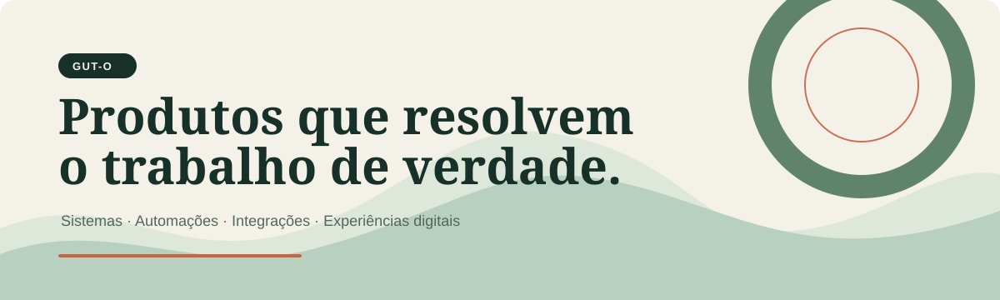
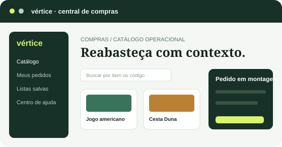
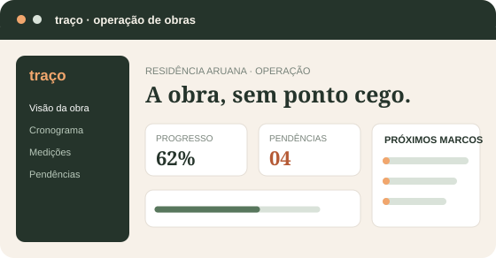
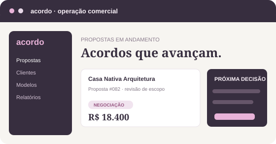

<picture>
  <source media="(prefers-color-scheme: dark)" srcset="assets/cabecalho-escuro.svg">
  
</picture>

  <a href="https://gut-o.github.io/"><picture><source media="(prefers-color-scheme: dark)" srcset="assets/botao-portfolio.svg"></picture></a>&nbsp;
  <a href="https://www.99freelas.com.br/user/gutomarchezan"><picture><source media="(prefers-color-scheme: dark)" srcset="assets/botao-99freelas.svg"></picture></a>

## O que eu resolvo

Sou engenheiro de software generalista. Entro no problema, desenho um fluxo claro e construo a experiência necessária para a operação funcionar melhor — sistema interno, integração, automação, API ou página comercial.

| Quando o problema é... | Eu construo... |
| --- | --- |
| Controle espalhado entre planilhas, conversa e retrabalho | **Produtos internos** para compra, atendimento, financeiro e operação. |
| Dados que não conversam entre ferramentas | **APIs e integrações** com regras, histórico e menos trabalho manual. |
| Rotinas repetitivas que consomem a equipe | **Automações e IA aplicada** com validação e rastreabilidade. |
| Uma oferta boa que ainda não se explica sozinha | **Landing pages** que organizam posicionamento e próxima ação. |

## Produtos em destaque

<table>
  <tr>
    <td width="50%" valign="top">
      
      
<a href="https://gut-o.github.io/trabalhos/vendasimples/"><b>Vértice</b></a> Compras B2B com catálogo, pedido, lista salva e acompanhamento.

    </td>
    <td width="50%" valign="top">
      
      
<a href="https://gut-o.github.io/trabalhos/obraflow/"><b>Traço</b></a> Obra, cronograma, medições, pendências e documentos no mesmo fluxo.

    </td>
  </tr>
  <tr>
    <td width="50%" valign="top">
      
      
<a href="https://gut-o.github.io/trabalhos/propostaflow/"><b>Acordo</b></a> Propostas, clientes, versões, aprovação e condições comerciais.

    </td>
    <td width="50%" valign="top">
       
      <h3>Mais produtos</h3>
      
<a href="https://gut-o.github.io/trabalhos/triagem-atendimento/"><b>Entrelinhas</b></a> · atendimento por fila e canal

      
<a href="https://gut-o.github.io/trabalhos/fluxo-caixa/"><b>Clareia</b></a> · financeiro, cobranças e fornecedores

      
<a href="https://gut-o.github.io/trabalhos/agendaflow/"><b>Ritmo</b></a> · agenda e reservas

      
<a href="https://gut-o.github.io/landings/"><b>Landing pages</b></a> · páginas comerciais por segmento

    </td>
  </tr>
</table>

## Stack e prática

`Python` · `FastAPI` · `TypeScript` · `JavaScript` · `React` · `C#/.NET` · `SQL` · `APIs REST` · `Docker` · `AWS` · `GCP` · `testes` · `observabilidade` · `LLMs` · `RAG` · `MCP`

 

  <b>Veja os produtos funcionando no <a href="https://gut-o.github.io/">portfólio</a> ou me encontre no <a href="https://www.99freelas.com.br/user/gutomarchezan">99Freelas</a>.</b>

